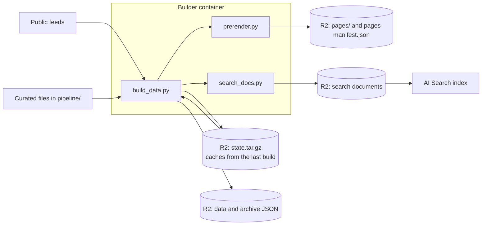

# How Cyber works

This page explains how the pieces of this repository fit together. To run Cyber locally, use the [local quickstart](../README.md#local-quickstart). To operate the hosted service, use the [operations runbook](operations.md).

## The short version

Cyber is one Cloudflare Worker plus a build that runs every hour.

- **The build** reads public feeds and the curated files in this repository, and writes JSON data, one HTML and Markdown page per record, and search documents.
- **The Worker** serves the site at `cyber.askgina.ai`. The application shell comes from `site/`; data and generated pages come from object storage (Cloudflare R2).

Nothing generated by the hourly build is committed to Git. A merge to `main` changes what the next build produces; it does not publish anything by itself.

## Hourly build

1. At `:07` UTC every hour, the Worker's cron handler starts the **Builder**, a container defined in `container/`.
2. The Builder downloads `main` from GitHub, then restores the caches from the previous build (`state.tar.gz`) over it. Code and curated files always come from Git. Caches and the previous snapshot come from R2.
3. `pipeline/build_data.py` fetches the feeds, merges them with the curated files, and writes `site/data.json`, `site/archive.json` and the split files (`data-hot.json`, `data-details.json`, `data-history.json`).
4. `pipeline/search_docs.py` writes one Markdown search document per record type per day. `pipeline/prerender.py` writes an HTML and Markdown pair for every public page, plus the sitemap, feeds and `llms.txt` files.
5. The Worker copies the outputs from the Builder to R2. It uploads only search documents and pages that changed, and writes the pages manifest last, so readers never see a half-published set of pages.

If the data build fails, nothing is uploaded and the site keeps serving the previous build. A failed search or page upload is logged, and the data build still counts as done.

## Serving a request

The Worker (`worker/index.js`) owns every route listed under `run_worker_first` in `wrangler.jsonc`. Everything else is a static file from `site/`.

| Request | Served from |
| --- | --- |
| `/data.json`, `/data-hot.json`, `/data-details.json`, `/data-history.json`, `/archive.json` | R2, with `ETag` and `Last-Modified` from the build that wrote the object (`worker/data.js`) |
| `/`, `/method`, `/api`, `/leaderboard`, `/report`, `/incidents/*`, `/patterns/*`, `/daily/*` | Prerendered pages in R2, as HTML or Markdown depending on the `Accept` header (`worker/pages.js`, `worker/negotiate.js`) |
| `/sitemap.xml`, `/feed.xml`, `/feed.json`, `/llms.txt` and the other discovery files | Prerendered files in R2 |
| `/api/search` | Cloudflare AI Search over the search documents (`worker/search.js`) |
| `/e` | Cookieless analytics events (`worker/analytics.js`) |
| `/__build` | Starts a build by hand; needs the maintainer `BUILD_TOKEN` |
| Scripts, styles, fonts, icons | Static files in `site/` |

The browser application (`site/app.js` and the files beside it) loads `/data-hot.json` first, then the details and history files on demand.

## Where records come from

| Kind | Source | Record ID prefix |
| --- | --- | --- |
| Curated incidents | `pipeline/incidents.json`, written by the maintainers. The build attaches matching press stories and official notices. | `r-` |
| Crypto exploits | DefiLlama and SlowMist | `c-` |
| Exploited vulnerabilities | CISA Known Exploited Vulnerabilities catalog | `k-` |
| Breaches | Have I Been Pwned breach catalog | `b-` |
| News | Security news feeds, Google News search and Hacker News | `n-` |
| Early signals | `pipeline/x_signals.json`, facts and links recorded by hand. Cyber does not collect posts from X automatically. | `x-` |

The build also reads ransomware leak-site claims from ransomware.live and official breach notices from public registers (`pipeline/official.py`).

Only records that meet the source requirements on the [Method page](https://cyber.askgina.ai/method) are offered to search engines. The others are served with `noindex` and are left out of the sitemap and feeds.

## Repository map

| Path | Contents |
| --- | --- |
| `pipeline/*.py` | The build. `build_data.py` is the entry point; `registry.py`, `enrich.py`, `xscore.py`, `gnews.py`, `hn.py`, `official.py`, `archive.py` and `translate.py` are its stages. `split_data.py`, `prerender.py` and `search_docs.py` turn the snapshot into the split files, pages and search documents. |
| `pipeline/*.json` | Curated input: `incidents.json`, `incidents_archive.json`, `analysis_notes.json`, `x_signals.json`, `x_accounts.json`, `crypto_aliases.json`, `today_brief.json`. The remaining files are build state. |
| `pipeline/archive_cache/` | Raw monthly pulls for the year-to-date archive. Tracked because page generation and the checks read it. |
| `pipeline/check_curated.py`, `pipeline/test_curated.py` | Offline checks of the curated input, run on every pull request. |
| `worker/` | The Cloudflare Worker: routing, data and page serving, content negotiation, search, analytics, and the code that starts a build and publishes its output. |
| `container/` | The Builder image and its small HTTP server (`server.py`), which runs the pipeline. |
| `site/` | The browser application and static files. `site/data.json` and `site/archive.json` are committed snapshots used for local preview and CI; production serves the copies in R2. |
| `scripts/` | The local Worker (`local-worker.mjs`) and the checks behind `npm run check`. |
| `wrangler.jsonc` | Worker configuration: routes, cron schedule, R2 buckets, AI Search, rate limits and the Builder container. |
| `.github/workflows/` | Pull request checks, Worker deploy, post-deploy verification and the hourly freshness alert. |
| `docs/baselines/`, `site.FLOWS.md` | Historical measurements and a description of the user interface flows. |

`pages/` and `search_docs/` appear after you generate fixtures. They are ignored by Git.

## Where to change things

| To change | Edit | Takes effect |
| --- | --- | --- |
| A curated incident or signal | `pipeline/incidents.json`, `pipeline/x_signals.json`, `pipeline/analysis_notes.json` | Next hourly build after merge |
| How feeds are fetched, matched or scored | `pipeline/*.py` | Next hourly build after merge |
| The HTML, Markdown or metadata of a record page | `pipeline/prerender.py` | Next hourly build after merge |
| The interactive application | `site/*.js`, `site/styles.css` | Worker deploy on merge |
| Routes, headers, caching or search | `worker/` | Worker deploy on merge |
| What the build container runs | `container/` | Worker deploy on merge |

## Names you will see

The project was first called Breach Ledger. The Cloudflare resources keep that name: the Worker is `breach-ledger`, the buckets are `breach-ledger-state` and `breach-ledger-ai-search`, and some code comments still say "Breach Ledger" or "the ledger". They all refer to Cyber.

"The hourly agent" in code comments means the maintainers' curation process that writes the curated files. It is not part of this repository.
